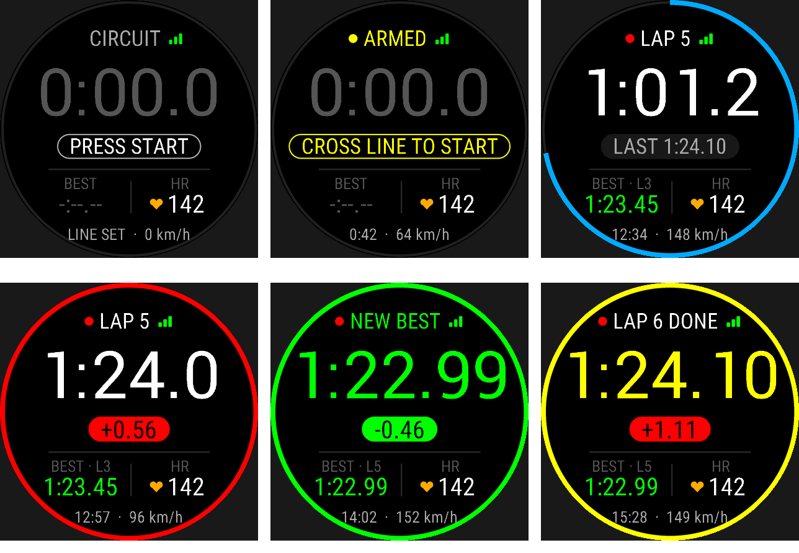
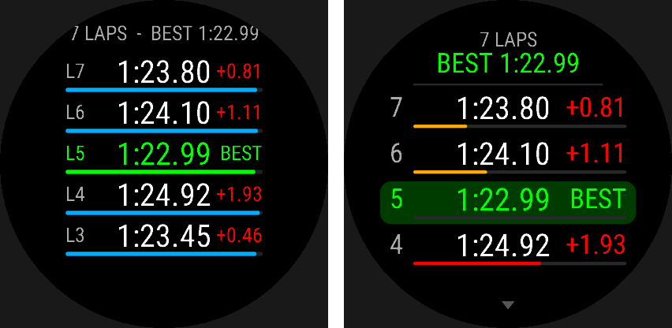

# GarminRace2

A GPS lap timer for motorsport and track days, built as a Connect IQ watch app for the **Garmin Venu 2**.



## Features

- **Accurate line detection.** Each timing line is a point plus a 25 m capture radius. The app checks the straight path between consecutive GPS fixes and interpolates the exact crossing time, so laps are timed to the hundredth and fast cars can't skip the line between 1 Hz fixes.
- **Direction aware.** Each line knows which way the track runs there and ignores passes in the opposite direction. If you set a line while moving, the direction is recorded straight away. If you set it standing still, it's learned from the first lap or run you complete.
- **Three modes.**
  - *Circuit* times laps across one start/finish line.
  - *Sprint* times A-to-B runs of a minute or more (hill climbs, stages) between separate start and finish lines. Finish crossings in the first 60 s of a run are ignored.
  - *Drag* times short A-to-B runs (drag strips, launch tests) with no minimum run length.
  Sprint and Drag re-arm after each run. Crossing the start line again before the first split restarts the run, so driving back through the start to stage is harmless. In Drag mode a launch from rest is timed assuming the car is accelerating, which keeps the start from being placed too early.
- **Live delta.** While you drive, the pill shows how far ahead (green) or behind (red) you are against your track record lap *at the same point on track*. The app compares your position with the record lap's recorded path. The bezel ring shows how far round the record lap you are, in the same colours.
- **Split lines and sectors.** Add up to two split lines (Circuit and Sprint) for three sectors. Crossing a split shows your gap to the record lap at that split. Lap history shows each lap's sector times, with the session's best sectors in green, and the optimal lap (the sum of your best sectors).
- **Saved tracks.** Keep up to 20 tracks, each with its own lines, mode and records. When the app gets its first GPS fix, it switches to the saved track whose start line is nearest (within 5 km).
- **All-time records.** Each track keeps its record lap, record splits and best sectors per mode, across sessions. Moving the start line resets that track's records, and moving the finish line resets its Sprint and Drag records. Changing splits resets only the sector bests.
- **Live feedback.** After each lap a coloured pill shows the gap to the record: green when faster, red when slower. The header shows *NEW RECORD* or *SESSION BEST*. You also get vibration and tone alerts on each lap and a short buzz at each split.
- **Heart rate** from the wrist or a paired strap, coloured by your Garmin HR zones, with max HR per session.
- **Saved to Garmin Connect.** Each session is recorded as a FIT activity (GPS track, heart rate, laps). The FIT file also carries the timer's own numbers as Connect IQ fields: the GPS-interpolated lap time, gap to record and sector times on each lap; best lap, optimal lap and track record in the summary; and a *Delta to Track Record* chart. The out-lap, and the transit between sprint or drag runs, are separate laps with these fields at zero.
- **No false starts while staged.** Crossings slower than 5 km/h never count, so GPS wander while you sit on the line can't start the timer.
- **Lap history page** (swipe up) with the gap to best for every lap.
- Lines and mode are remembered between launches.



## Controls

| Input | Action |
|---|---|
| **START** (top button) | Start session / stop and save (asks to confirm) |
| **Hold BACK** (menu) | Track, mode, lines, splits, lap history, clear lines |
| **Swipe up** | Lap history |
| **BACK** while recording | Asks to save and exit |

Screen taps are ignored on the main screen, so a bumped wrist can't stop a session.

## Using it

1. At a new track, open the menu, choose **Track › New Track** (and **Rename Track** if you like), then pick a **Mode**.
2. Choose **Set Start/Finish** while standing on (or driving across) the line. In Sprint and Drag mode, set both the start and the finish.
3. Optionally, choose **Add Split Here** at up to two points around the lap, in the order you drive them.
4. Press **START**. The app arms and waits for you to cross the line.
5. Lap timing begins at the first crossing. Every crossing after that records a lap.
6. Press **START** again to stop and save to Garmin Connect.

Next time you're at that track, the app selects it automatically. Track, mode and line changes are locked while a session is running.

## Building

Requires the [Connect IQ SDK](https://developer.garmin.com/connect-iq/sdk/) and a developer key.

```bat
build.bat
```

Or directly:

```bat
monkeyc -d venu2 -f monkey.jungle -o bin\GarminRace2.prg -y path\to\developer_key -w
```

`build.bat` looks for the key in `%DEV_KEY%`, then `developer_key` next to the script, then `..\..\GarminRace\developer_key`. Keys are gitignored. Never commit yours.

### CI

GitHub Actions (`.github/workflows/build.yml`) builds the app on every push to `main`, on pull requests, and on demand from the Actions tab. The built `GarminRace2.prg` is attached to each run as a downloadable artifact.

To sign CI builds with your own key, add a repository secret named `DEVELOPER_KEY_B64` holding the base64 of your `developer_key` file (PowerShell: `[Convert]::ToBase64String([IO.File]::ReadAllBytes("developer_key"))`). Without it, CI signs with a throwaway key, which still checks that the code compiles.

## Installing on the watch

The Venu 2 connects as a media (MTP) device. In File Explorer, copy `bin\GarminRace2.prg` into **Venu 2 › Internal Storage › GARMIN › APPS**, then unplug the watch.

## Project layout

```
source/
  GarminRace2App.mc         app entry, GPS + heart-rate sensors
  RaceSessionModel.mc       timing, splits, live delta, records, FIT recording
  Track.mc                  saved tracks, modes, records and their storage
  LapTrace.mc               lap path recording and position matching for the live delta
  RaceFit.mc                Connect IQ developer fields in the FIT file
  TimingGate.mc             line-crossing detection and interpolation
  GarminRace2View.mc        main race screen
  LapHistoryView.mc         lap history page
  GarminRace2Delegate.mc    buttons, confirmations
  GarminRace2MenuDelegate.mc menu
  RaceAlerts.mc             vibration, tones, toasts
  TimeFormat.mc             time formatting
resources/                  strings, launcher icon, FIT field labels
```
